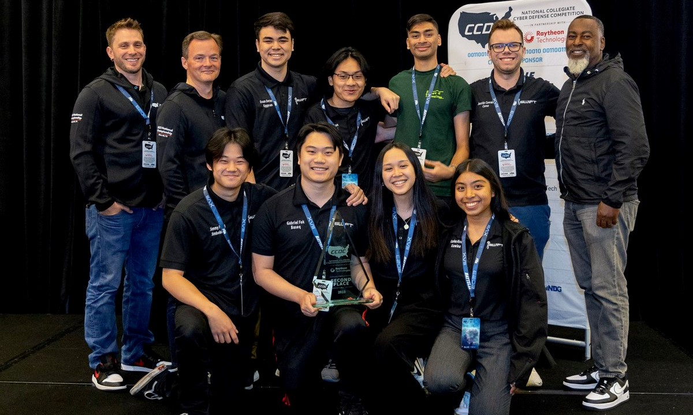
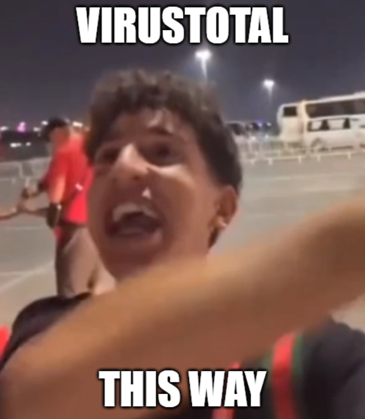

Another day another national competition another picture where I looked cooked af. This time around: CCDC[^1]

If you are from the red team or are interested in my thoughts on the red team I recommend you skip to the bottom of this post. 

# Starting out
Well the chronicles of cyber competitions collegiate edition brought some fun experiences this time around. CCDC has always been on my mind and I was excited to finally throw myself into it, particularly with the Cal Poly Pomona team. 3 of the team members are ex-CyberPatriot[^2] national finalists so there were some elements of familiarity with the competition and the people around me. In addition to the familiar faces, CPP has quite the acclaimed CPTC[^3] team so having some overlap between the two teams meant we had a sort of full circle of experience.
## Adaptations from CyberPatriot
Most of these changes are relative to the National finals CyberPatriot holds as it's essentially a mini form factor CCDC. 
### Scale
The first major change is the scale of CCDC. Depending on the region environments can range anywhere from 7-40 boxes. At first glance, it doesn’t really seem that bad given the team size is 8 people, but our team split meant we only had 1 dedicated Windows admin, yours truly 😎. If you’re interested in numbers that equated to about 3, 10, and 17 windows boxes at each of the rounds. Stats aside, our team composition meant scripting was a must for Windows. The biggest thing to understand about WRCCDC is that less is more. If your script looks like a harry potter book I promise you are doing it wrong. My main strategy was to utilize WinRM to fire off small scripts against an entire domain of machines, more on this later.
### Usability
The second major shift was ensuring usability, It’s very easy to just take your 5-year-old vulnerability-ridden WordPress site, convert it to static HTML pages, and host those, but to ensure the orange team (mock users) can actually use your service is a whole different approach. Even greater a challenge than deprecated apps is maintaining domain authentication. WRCCDC does an amazing job of introducing new applications and services that rely on domain connectivity, some of which require legacy access. So securing the domain is harder than just disabling NTLM or firewalling it off to oblivion, you have to carefully disable select things using your understanding of AD dependencies and some good old trial and error (ain’t nobody reading documentation to figure out LDAP requirements).
# Strategy
How to win for dummies: let's make some red teamers mad.
## Team Composition
Here at CPP we're big advocates for an ever-changing team composition. Sure some positions always need to be around like a networking, windows, and Linux admin. But, the rest of the positions can be flexible, and in our opinion, should be. You will have much better experiences and results if you tailor to people's strong suits. For example, [Justin](https://www.covertops.xyz), our IR guy, is quite the detection demon and has a natural affinity for red team operations (makes sense he was this year's CPTC captain) so it plays into the team's advantage creating a dedicated IR role and having him manage our SIEM and hunt for red team activity. Conversely, given CCDC's (WRCCC and NCCDC) usual heavy Linux skew, the team opted for only 1 dedicated Windows admin, me. This is a bit more of a radical choice and I don't think this choice was made specifically because of my experience but was reinforced by it. This is not something I would encourage most people to do since even I had my issues playing this role. Either way, we went from having 3 dedicated Windows admins to 1 which enabled the possibility of 2 more roles. This allowed both returning 2022 Windows admins to spit off and take networking and business roles, both of which played into each person's strengths.

Overall our composition looked a little something like this:
 - Player 1 - Windows Lead
 - Player 2 - Networking lead, Windows
 - Player 3 - Linux Lead
 - Player 4 - Web Lead, Linux
 - Player 5 - Threat Hunter, Linux
 - Player 6 - Business Lead
 - Player 7 - Business, Networking
 - Player 8 - Captain/Manager, Linux, Business

If I were to make a change to this it would be to have a designated DB admin. At nationals we were unaware of its criticality and so it was treated as a normal box. However, in hindsight, it would have been nice to have someone dedicated to it knowing that about 5 services relied on it.

The manager is also a fairly abnormal role in my experience. In fact, I was somewhat against this role when I first started because I had the belief that everyone should be hands-on-keyboard so as to not waste time. However, with the speed and scale at which things happen, our captain [Gabe](https://gabrielfok.us) was pretty invaluable since he had complete oversight as to who was doing what and could ensure everyone was on track. Ultimately this role falls out of use towards the end if you have most things going to plan, but it's crucial in the initial stages of the competition.

## Competition Approach
Since I'm not retired yet I can't really say exactly what we did, CCDC is still largely formulaic meaning there is not much stopping another team from challenging us or Stanford, so in the interest of winning I won't be going over pivotal specifics. But the general approach we took is what everyone has been recommending and hearing for years. Start with the simple stuff, change credentials, mitigate important vulnerabilities, and put up a strong network defense. We pretty much followed this verbatim, with a few cool tricks up our sleeves. 

First order of business: clunky physical laptop. Honestly, this part is like 1 deny all firewall rule, and then you can call it a day. The reason I say it's the most important is because if you leave holes here the red team will probe at them and use them to harvest information like ESXI web sessions, machine credentials, and even room audio. Dan Borges actually talked about the hot mics in his [2023 NCCDC Red Team blog](https://lockboxx.blogspot.com/2023/05/red-teaming-at-national-ccdc-2023.html) (love me some Alex Levinson aka red team jesus eavesdropping). 

The second biggest priority for me was locking down the DCs. Luckily there is not too much AD magic going on so you don't have to worry too much about nuking things. My top priorities were changing creds, specifically the krbtgt password, and disabling NTLM. I prioritize the krbtgt password to stop the red team from using default creds they pull off of another shit team and using them to create a golden ticket against us. NTLM removal is more of a quick nice-to-have that we can implement almost instantly that just makes their job harder in the short-term. When I refer to "harder" I'm speaking more to the idea that there is a chance we can interrupt some of their automated behaviors and force them to manually verify more things, which in turn leads to a higher possibility of missing complete coverage.
> The red team will play many games, the goal is to piss on those games to ruin their fun.

Once the DC is chilling all that's left for our initial plan was to fire off PowerShell scripts against the entire domain. I say this like it is a straightforward task but it's quite the opposite. The biggest issue in this is having consistent connectivity to every box before the script can be run. Luckily in the spirit of making the red team's job easier WinRM was enabled and configured out of the box for nearly every machine. I say nearly because there are some weird caveats to this, like when Windows 10 automatically sleeps causing the network adapter to turn off, or when DCs fall out of sync because of rapid cred changes. In my case, it was a distant relative of the latter. People who frequently deal with AD will know how much behavior varies from environment to environment and so double tapping the krbtgt account password at nationals resulted in kerberos taking a potty break and subsequently throwing its shit at my face (every account stopped authenticating LOL). So what was a solid automation plan turned into our networking/backup Windows guy [Evan](https://evandeters.com) and I manually hardening all 17 Windows boxes. At a high level, after the scripts have finished running, web app creds have been changed, and firewalls are up, there isn't a straightforward way for the red team to get to you. They then have to resort to more ✨Creative✨ measures.
### In a perfect world
Our main remote execution wrapper script would have taken care of running each of our standalone hardening scripts across the domain in the following order:
 - Inventory.ps1 - Collects information from each host such as users, startups, software, shares, and IIS site bindings.
 - Fix.ps1 - Resolve any QOL issues like crazy fonts, hidden folders, non-English keyboards, and GPO roadblocks.
 - Smb.ps1 - Disables SMBv1, forces security signatures, and deletes default shares.
 - Php.ps1 - Disables dangerous functions and file uploads dynamically by finding all php.ini files.
 - Log.p1  - Enables all types of PowerShell logging, sets audit policies, and installs Sysmon.
 - Users.ps1 - Creates a new admin account and changes all passwords to something random.
 - Hard.ps1 - Implements pass-the-hash mitigations, configures Windows defender and its extended capabilities, and sets up some fun tricks for red team to scratch their heads at.

### Inspiration
I'm not gonna lie I did not come up with all of these ideas on my own. Nor did I write all of the scripts from scratch. I spent a lot of time sourcing relevant ideas from my CyberPatriot Windows script, reviewing other teams' scripts, and talking with friends who had CCDC, specifically nationals, experience. I was very familiar with everything used in our Windows strategy and scripts, but being a bit of a perfectionist you always feel like there is a better way to order your operations so I was constantly shifting stuff around.

For example: The entire concept of our Fix.ps1 script came from UCI, Php.ps1 concept from DSU, and some funny red team annoyances from DSU or RIT (can't remember). 

### Preparation
When it came to deriving our strategy we had a pretty good idea of the general things we need to do. We knew we had to have a multi-stage plan that progressed in accordance with how the red team and competition progressed. And we knew the first stage had to be fast. However, nothing beats real experience and so to have [Shane](https://sourque.com) (2022 CCDC Runner-up) constantly giving us feedback was invaluable. Truth be told, though we were a first-time national team, thanks to our GOAT mentor, CyberPatriot experience, and hours of OSINT, I'd argue we understood the competition better than most veteran teams. 

Without a doubt I'm most proud of our competition OSINT, shout out to [Justin](https://www.covertops.xyz) on our team for heading these efforts. CCDC has been around for a while and finding past resources, blogs, and tools is not at all hard to do on a surface level. However, you have to dig deeper for the good good. Someone very knowledgeable I talked to put it this way, "NCCDC Red team is a dick-measuring contest", so what's the point if you can't gloat about it? Hence, there is a lot to learn from stalking known members' GitHub accounts, Twitter posts, Twitter likes, books, blog posts, and IRL conversations. Going into nationals we knew what C2 framework we were going to get hit with, what type of keyloggers would be deployed, what persistence mechanisms would be implanted, what the attack path would look like, and what insane tools they had been cooking. We had mitigations/mental notes for almost everything that had been publicly tied to NCCDC red team members in the last few years, and even the current year. I want to say we are among the first team to go to this extent, but I can't say this with confidence since a lot of other teams like to keep quiet about what they do. Either way, our red team picked up on this and we had quite a fun chat with them after day 2.

# The Competition
Up the smoke
## Day 1
The red team has apparently and historically been pretty silent on day 1. In the last 2 years, this has not been the case. Windows saw the usual exploitation of Eternal Blue followed by payloads dropped to disk and injected into memory. However, we only saw service artifacts on one of our systems. So considering the fact that we didn't have full coverage until about 2 hours in I find this surprising. 1 of 3 things happened, or maybe all who knows, in an effort to be more silent they only exploited high-value targets (the DNS box which they mistook for being the DC) and assumed they could pivot from there, they had some very stealthy initial RCE technique that was not picked up by our brief forensic analysis, or they assumed Defender would be disabled and didn't have any stealthy initial access methods. I think they got caught out by the 3rd option since we noticed 7045 Event IDs (Service Creation) on the DNS box and saw Defender alerting it had prevented exploitation on several other hosts. Our team was under the impression that we would be starting with an incredibly misconfigured environment and thus didn't anticipate having Defender on our side. I guess the ops team decided to bless us this year. Aside from the Eternal Blue artifacts on the DNS box, we saw no other initial hands-on-keyboard activity on Windows. I searched for persistence using autoruns quite thoroughly and found absolutely nothing on any of the systems, except the good old DNS box which had interesting DLLs and non-ascii users. I'm not sure if they planted more advanced mechanisms that autoruns misses or just completely failed to gain an initial foothold. Either way, I'm not complaining. 

Linux was a bit more interesting. We saw some initial hands-on-keyboard activity on the DB box which was a bit concerning but we knew we just had to continue onwards. Towards the midway and end of day 1 we realized that it was a fairly large dependency serving about 5 or 6 unique databases for various web applications. This was not a great sign especially since we hadn't prioritized this box as much as we probably should have. A fair amount of the Linux hosts were completely locked down by the end of the day so that was a big positive.

We had our teammate Jimmy changing web app creds so once we put some basic OS-level measures into place we were pretty much set for the rest of the day. By tradition, there is always a centralized logging inject which means by the end of day 1 we also had a Wuzuh server up and running with most of the Linux systems reporting back to it. Windows was largely left out because I was incredibly confident in our ability to prevent breaches on Windows and could dedicate that manual agent setup time elsewhere.

The last order of business making our own inventory sheet. The welcome packet is actually VERY informative but intentionally lacks details like which scoreboard services correlate to each box. So our captain took information from everyone and made a complete list of every scored service and its related box. This sheet was quite literally gold for day 2 when it came to remediating red team activity based on scoreboard downtime and having a point of reference.

## Day 2
We were certain the Linux DB box had been blasted to oblivion and came up with a plan the night of day 1 to contain and harden it. Unfortunately, we found the red team to be very aggressive with dropping data. They started much sooner than we had anticipated so we had to throw that plan out the door when it was clear we were fighting a losing battle. We knew we couldn't outclass them in Linux knowledge so our best bet was to start with a brand new copy of the box, turn off the network adapter, and harden it offline. I explain this in very simple terms but we definitely had people panicking and the DB exploitation did cause us to accumulate like 40 SLA violations. We had a few Linux incidents aside from that but their impact was minimal. The most notable was our Linux laptop getting pwned. We left SSH open from when we were previously moving files around and someone had the great idea of intentionally using the same password for almost all of their accounts so the red team was able to just SSH in with known plaintext creds. With a little bit of luck and skill, we caught them a few minutes in and fully remediated the laptop.

Windows was pretty damn clean. We had 2 notable events, 1 of which was self-inflicted. The self-inflicted had to do with our Linux database restoration. Before we decided to roll back the DB box and start from scratch we were restoring the databases from a backup we had taken on day 1, then in an effort to save a revert we tried to migrate each CMS to a per-service MySQL account with incredibly restrictive permissions. This blew up 1 because some CMS services need weird delete perms or they explode, and 2 because 1 of the Windows web servers was running a CMS that had no online documentation as to where the config file was. So we spent a long time trying to find the file and even tried to restore the previously working SQL database, but to no avail. It ended up being an issue with us importing the SQL backup in a misnamed database, but it also didn't help that we didn't identify the CMS config file until later. Lessons learned: Document your backups and learn how to grep with PowerShell. The 2nd event was indeed a red team. They were able to delete data from my DNS server which was surprising to me since I was very confident that they were not lingering on the system. They did it twice, the first time I was weary of calling it a red team incident and thought it could be some weird child domain DNS replication issue. However, when the same happened about 2 hours later I was sure it was red team activity and changed a configuration I had previously known about to prevent it from happening again. To restore the data each time I just recreated the DNS zone from a .dns file backup I had taken.

Funny enough Wuzuh was our strangest issue on day 2. We had a Wuzuh install script to stand up our instance. However, we had 2 opsec failures which led to the red team gaining control over the instance. 1st we had a plaintext password in the install script. Since it wasn't hardcoded from our GitHub repo we didn't think it needed to be changed. And 2nd, the larger issue that led to the first being exploited, was the fact that we were hosting the Wuzuh agent installers in the same directory as the install script, meaning when the red team scanned our subnet they found our HTTP file server and were able to read the password from the install script. Using the agent installer they threw it on their own box and started flooding our logs to make them useless. We caught this pretty quickly and tried to firewall the rogue host off but an iptables hiccup meant our command was ineffective. After flooding logs, they accessed the Wuzuh management interface and used Wuzuh to sinkhole all network connections to some of our Linux boxes using Wuzah's active response capabilities. It took us a bit to realize that they were in our Wuzuh interface and remediate the network sinkhole. To my recollection, some quick network commands and a reboot were good enough to get the Linux boxes back online, but that didn't stop our Linux team from feeling the pressure. We ended up turning off Wuzuh and flew the rest of the competition blind since it wasn't worth turning on the Wuzuh server again just to have it flooded.

## Man's Best Friend: Adrenaline
The greatest unspoken challenge of the competition was literally living. Waking up at like 5 am PST was something I was used to for cyber competitions, in fact, it was somewhat of a luxury compared to the 4 am PST wake-up of CyberPatirot's national finals, but something about this trip was different. I came in with some seasonal sickness (hate spring) and this combined with the wacky wake-up times and general stress led to me waking up shitfaced both days. Usually, I can ego through most stress but this whole combination might have been the closest I've ever gotten to pulling out of a competition. I usually point and laugh at people when they tell me they fell asleep in the middle of something, looks like karma caught up because I fell asleep 4 times during the opening ceremony and orientation. Everyone jokes about sleeping through sponsor messages, I guess I forgot it was a joke 💀. I think everyone else on my team was too busy paying attention to the opening remarks to realize how close to a doomsday-level event we were, I'm talking like 1 second from midnight. I said this afterward, but if we had any of our alternates present I would have subbed out.

The first few minutes of the competition were tough but after about an hour in the fight or flight adrenaline kicked in and I had enough energy to tank a horse tranquilizer. I'm very notorious for being nose-to-screen for the entirety of competitions so I wasn't planning on eating much, more time to work right? Day 2 was like fighting the 2nd wave of a boss fight you thought only had 1 wave. Pros: I had a plan Cons: felt like dying. About 30 minutes in the adrenaline kicked in and I was locked in for the rest of the day. "where there's a will there's a way" - Sun Tzu (probably). It definitely helps that I hate losing so much otherwise there's no way I would have willed myself through that, thats some inspirational Lego Ninjago shit right there. Over the span of 72 hours I probably had 2000 calories, 10 hours of sleep, and enough adrenaline to save a small village from a natural disaster.

> On a side note Ima have to throw hands with whoever made the vegetarian lunch STRAIGHT LETTUCE

# Final Thoughts
## Placement
2nd place is good and bad. For how badly we screwed up managing the database 2nd was a miracle. For the potential and guidance, we had 2nd was underachieving. For the entire season, I had been pretty adamant that in a competition scenario, we had the best technically capable team and I still stand by that but winning comes down to split-second decisions. We were only 650 points or so off of first which meant that whichever team played the cleaner game would ultimately win. Stanford had lots of really amazing people, so there are no hard feelings, if anything, we came out of nationals with a stronger alliance. If things play out the same next year and we both find ourselves at nationals with UCF, I'm sure we'll have some fun.
## Red Team
NCCDC's Red team is pretty widely known both in competition and industry. Everyone on the core red team is some infosec prodigy, meaning under normal circumstances you will get boxed and shipped to Mars. Most people find the speed and complexity of their attacks baffling, for me, it was their visibility. We could stand up a new service or revert a box and within minutes red team would know about it. If I had to guess I would say they have some tool constantly scanning and diffing results. 

CCDC at the end of the day is a game, and like red team lead David Cowen says "Congratulations, you played the game". When the DC turns into a FTP server there are some fundamental laws red team can't bend. It's like the laws of physics, you just can't break into certain boxes. Or can you? This is where the gray area starts because there have been occurrences in the past where the red team has done some insane things like LSASS hooking and Linux rootkits but they seem to have moved away from this on the Windows side in recent years. I think they need to bring this back. In its current stage, NCCDC is too easy. If I can win against 3 red teamers on 17 windows boxes **SOLO and MANUALLY** something needs to change. Especially when we're finding beacons we default configs.

My thought process is that if I can screw with enough people's ego there will eventually be some retaliation, and this is when we can start the real fun. So with that said, I'd like to informally challenge the core red team to try and do something to CCP's windows boxes, I want you guys to try and trash it with persistence and beacons. In the meantime, I will be waddling around laughing at the scoreboard. 

Until next year fellow red team enjoyers 😏

---
{: data-content="footnotes"}

[^1]: The mission of the Collegiate Cyber Defense Competition (CCDC) system is to provide institutions with an information assurance or computer security curriculum a controlled, competitive environment to assess their student's depth of understanding and operational competency in managing the challenges inherent in protecting a corporate network infrastructure and business information systems. (via nccdc.org)
[^2]: CyberPatriot is a national youth cyber education program created in the United States to help direct students toward careers in cybersecurity or another computer, science, technology, engineering, and mathematics disciplines. The program was created by the Air Force Association.
[^3]: At its heart, CPTC is a bit different from several other collegiate Cybersecurity competitions. Instead of defending your network, searching for flags, or claiming ownership of systems, CPTC focuses on mimicking the activities performed during a real-world penetration testing engagement conducted by companies, professional services firms, and internal security departments around the world.
