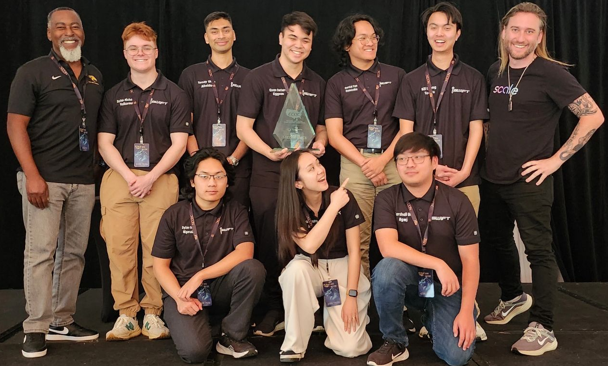
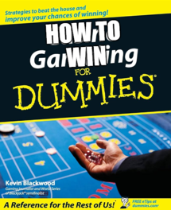
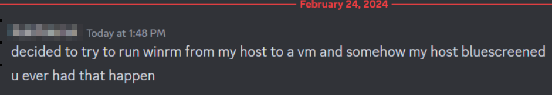
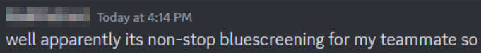
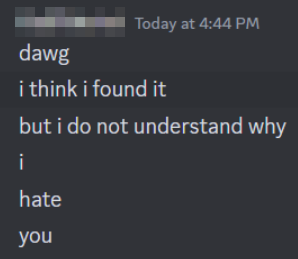
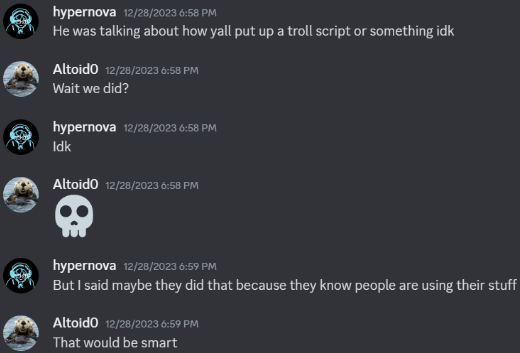

#### Table of contents
- [Building on success](#building-on-success)
- [Strategy](#strategy)
  - [Mentality](#mentality)
  - [Team Composition](#team-composition)
    - [Web Lead](#web-lead)
    - [Database Lead](#database-lead)
    - [Threat Hunter](#threat-hunter)
- [Tool Development](#tool-development)
  - [Speed](#speed)
  - [Theoretical Script Limitations](#theoretical-script-limitations)
  - [Dovetail](#dovetail)
  - [Development Mindgames](#development-mindgames)
    - [Wininit](#wininit)
    - [Bubba Gumper](#bubba-gumper)
    - [Misc.ps1](#miscps1)
- [The Competition](#the-competition)
  - [WRCCDC](#wrccdc)
    - [WRCCDC Competition Exerpience](#wrccdc-competition-exerpience)
  - [NCCDC](#nccdc)
    - [NCCDC Competition Exerpience](#nccdc-competition-exerpience)
      - [Day 0](#day-0)
      - [Day 1](#day-1)
      - [Day 2](#day-2)
      - [Day 3](#day-3)
- [Feedback](#feedback)
  - [WRCCDC](#wrccdc-1)
  - [NCCDC](#nccdc-1)
- [What's next?](#whats-next)
  - [Learning Plateau](#learning-plateau)


"We're smiling but 2nd place sucks" Feat. Alex Levinson

> The following post is a mix of my thoughts, obersations, and advice to competitors, volunteers, and organizers after competing in CCDC at the regional and national level for 2 years.

# [Building on success](#building-on-success)
Coming off the back of a dark horse CCDC season we were back for one last face-off. Truth be told, we were happy to have placed 2nd in our previous and first outing at nationals. However, with an abundence of mistakes, there was a lot left on the table. Our biggest takeway from the 2023 season was that our technical strategy and team composition were largely correct. Given that these are the two biggest topics to address with aa new team, all signs pointed to a succssful 2024 season.

# [Strategy](#strategy)

## [Mentality](#mentality)
One of the biggest prerequisites I see in competitions like this is a hyper-competietive mindset. Successful teams and competitors take years and unhealthy addictions to build. In my opinion, teams only reach the neccessary level of dedication when there is a baseline level of convition paired with a ~~hatred~~rivalry against some adversary. Find adversary, and you'll find or develop the right people.
## [Team Composition](#team-composition)
Flexibility is mandatory in this competition. Every team needs 4 core roles: Windows, Linux, Networking, and Business/Inject Handler. Each of the 8 team members needs to pick a specialization, but also take up a secondary. It's impossible to perfectly predict the technical and business/inject challenges. Thus, people need to be ready to adapt at a moments notice. As far as our team goes, we continued with a relativly similar composition to the previous year. We retained a heavy emphasis on Linux, added some help on Windows, created dedicated roles for Web and Database, and ensured that everyone was capable of handling injects on their own.
### [Web Lead](#web-lead) 
In anticipation of the technical challenges we'd face we opted to have a dedicated Web Lead. If you think about it, most modern apps are websites and/or use HTTP protocols so this was a fairly reasonable projection to make. Web remained a significant portion of our services at both WRCCDC and NCCDC, meaning this role payed dividends. One of the greatest yet understated benefits is having someone who understands the scope of our mock company and can aleviate stress for the OS-specific people as they focus on host-based security. More often than not the orange team (mock customers) IT calls account for a siginificant part of our overall score. Our ability to score points here depended on our web lead's ability to map out the ficticious company and understand the scenario. For example, at nationals we had a company ecommernce site that allowed customers to purchase our services. However, on the phone call, all you're asked is "What is the difference between the __ and __ service?". It becomes our reponsibility to quickly figure out what they are reffering to and provide a correct answer. This is where having a dedicated Web Lead comes in handy.
### [Database Lead](#database-lead)
Following our last year's tragedy with the database box being heavily targeted and owned, we assigned a dedicated person to serve as database admin. This way the entirety of web-related security is accounted for and the stress of managing a variety of individual services in taken off of the core OS leads. Having a database lead also allows for a more focused approach to securing the database box and its dependencies. This team member is in charge of mapping out web dependencies, creating service isolated databases, and rotating passwords. Since the web and database admin makeup two people, they can easily collaborate on security and inventory notes. During the initial stages of the competition, our web and database admin were relatively secluded from the rest of the team, however, that was intentional and beneficial. They key to making this setup work is having each of these leads take strong notes and communicate their findings to the rest of the team when appropriate. In between days one and two of the competition, these leads were able to give a detailed overview of the company's services which helped the rest of the team understand dependencies they may have overlooked and advanced our understanding in the competition lore.
### [Threat Hunter](#threat-hunter)
Threat hunter this year was a little different for us. Instead of having someone dedicated to setting up a SIEM and managing all aspects of it, the role was more dyanmic. Our threat hunter's responsibilities included SIEM stand-up (should it be needed), SIEM related inject tasking, and general linux assistance. This role changes the most round by round given the nature of each stage of the competition. At qualifiers we aren't given machines capable of running any type of SIEM (nice cyber defense comp). The threat hunter's job is to create some type of jank centralized logging solution that can atleast ingest events for inject points. At regionals, we have resources to play with, so the goal is to have a full SIEM setup and ready for any inject related tasking. However, WRCCDC decided to be a little different this year (one could even be brave enough to say kind?). We were given a graylog instance with agents deployed, to Windows hosts at least. This was nice because it saved us setup time, however it also meant that we were sort of *forced* to use it since it didn't make sense investing more time to redeploy our own. The largest downside was our lack of familiarity with graylog. Our instance ended up breaking itself and it took some planning in between days one and two in order to get it back up and running. At nationals, we had total control over our environment and opted to use Elastic Stack. This solution has a lot of cool integrations and a good search dashboard. It's greatest appeal was the ability to create dedicated dashboards and subsequently, visualizations. The idea was to use these visualizations in inject responses as an easy means to answer analytical questions like "Top 10 ports by traffic" or "Top 5 users by failed logins". This role is a bit of a jack of all trades being that they must understand how to operate different SIEMs, Windows security, and linux security. It's crucial to have someone telented and dedicated who can pivot between tasks and assist where needed.

Our revised composition was as follows:
 - Tanay (Me) - Windows Lead
 - [Dylan M](https://www.linkedin.com/in/dwmichalak/) - Windows Admin
 - [Dylan T](https://x.com/d_tranman) - Linux Lead
 - [Derrick](https://www.linkedin.com/in/derrickttran/) - Web Lead, Linux Admin
 - [Bill](https://www.linkedin.com/in/bill-luong/) - Database Lead, Linux Admin
 - [Marshall](https://www.linkedin.com/in/marshall-j-ung/) - Threat Hunter, Business, Linux backup
 - [Jess](https://www.linkedin.com/in/jessicacleung/) - Business Lead
 - [Evan](evandeters.com) - Captain, Networking, Business, Windows backup

A few changes to point out, everyone was mandated to do injects whether or not their role explicitly mentioned it and Captain was no longer hands-off. Our last year interpretation of the captain role was that it should be very managerial, prioritizing communication over technical impect. With a solid understanding of the competition and half of the previous team returing, we were confident everyone could operate independently and communicate without the needing to sacrifice one set of hands. If you're a team that potentially lacks high-level experience or has novice members, a hands-off captain would likely be beneficial.

# [Tool Development](#tool-development)
## [Speed](#speed)
If you've read my [previous post](../23-ccdc-nationals-reigniting-the-legacy) about the 2023 season, you'll know that my primary emphasis at the time was developing a system to operate at scale. Given our team composition was largely the same, my goal for the 2024 season was to optimize my workflow in terms of speed. Being fortunate enough to make Nationals as a Freshman allowed me to develop an understanding of the competition's quirks at each stage. WRCCDC tends to have at least one legacy or odd-ball box where as Nationals is surprisingly clean cut. Throughout the season I made multiple revisions to my previously garbage `Run.ps1` dispatcher script in an attempt to make it as fast as our Linux equivalent, [Coordinate](https://sourque.com/projects/coordinate/). As before, the core idea was to have our dispatcher utilize WinRM to fire off small tailored scripts against all boxes to take host inventory, implement hardened configs, and further deploy tools. The primary optimization I had in mind was concurrency (Yes I was using a "dispatcher" that was not concurrent :clown_face:). I'll share some funny moments and explain my Windows scripts in detail down below, but the most up-to-date and independently maintained version can be found [here](https://github.com/Altoid0/Dovetail).
## [Theoretical Script Limitations](#script-limitations)
There are a couple of limitations with the way Windows script dispatching works, specifically in a CCDC environment. The biggest is the dependency of WinRM. WinRM honestly works way better than I had initially ever expected it to. It is enabled by default on modern Windows Servers and permitted through the firewall. However, in the name of security. Microsoft has made its firewall exclusion only applicable to the local subnet when a machine is configured to run on its "Public" firewall profile. Most of the times, CCDC starts with the firewall off/down. But, given that we saw defender enabled out of the box at NCCDC last year, I was skpeticle about firewall starting down on all boxes. If we walk in with our first 15 minute plan relying heavily on the success of script deployment then any hiccup can add a sigificant hurdle to that plan. **It is worth noting that Dovetail.ps1 did work at nationals this year since firewall was off and most of the Windows boxes were all on the same subnet. However, it's important to understand the different scenarions you could envounter.**
> Ok so WinRM is largely good, but it's not perfect for our use case. What about just using PsExec?

PsExec is a great methodology for mass executuon, it has a Microsoft implementation and relies on port 445 which is always open in a CCDC environment. However, how do you get script output back? Maybe I'm missing something, but the level of output and error logging I can achieve with WinRM and my `Dovetail.ps1` script is not something that I can easily and reliably replicate with PsExec. Not to mention. Additionally, Microsoft's PsExec does not run asynchronously when given a list of hosts, meaning 1 script could hold up the line when executing across a large range of hosts unless you spawn N number of PowerShell windows for each box. Based on my own testing with certain scripts and the NCCDC environment this year, if we would have used PsExec.exe it would have taken roughly 30 minues to deploy all scripts. At that point I might as well just use Dovetail and quickly troubleshoot unresponsive hosts.

## [Dovetail](#dovetail)
For rounds where Dovetail was used, the following child scripts were executed in this order: 
 - Inventory.ps1 - Collects information from each host such as users, startups, software, shares, and IIS site bindings.
 - Fix.ps1 - Resolve any QOL issues like crazy fonts, hidden folders, non-English keyboards, and GPO roadblocks.
 - Smb.ps1 - Disables SMBv1, forces security signatures, and deletes default shares.
 - Php.ps1 - Disables dangerous functions and file uploads dynamically by finding all php.ini files.
 - Log.p1  - Enables all types of PowerShell logging, sets audit policies, and installs Sysmon.
 - Users.ps1 - Creates a new admin account and changes all passwords to something random.
 - Hard.ps1 - Implements pass-the-hash mitigations, configures Windows defender and its extended capabilities, and sets up some fun tricks for red team to scratch their heads at.

## [Development Mindgames](#development-mindgames)
What even is a competition if you can't be competetive and have a little fun?
### [Wininit](#wininit)
`Wininit.exe` is a critical system binary responsible for the startup and shutdown process in Windows. 
> That's cool and all but how does this relate to scripting?

Aside from the cool [RPC research](https://www.akamai.com/blog/security-research/cant-wait-to-shut-you-down-msrpc-wininit) people do, it has a very interesting characteristic. When the `wininit.exe` binary is executed from something like an elevated PowerShell session it crashes the computer causing a BSOD.
> Weird but cool? I still don't get what this has to do with scripting.

Dispatcher tools are probably the most imporant type of scripts someone can develop for this competition since they allow you to do security at scale. Given that our `Dovetail.ps1/Run.ps1` script was so far ahead of other publicly available alternatives I wanted people to actually read the code to figure out how the tool worked and how they could learn a little and write their own. I decided to have a little fun. I added a line that had ran `wininit.exe` such that whenever someone would run the script elevated and without reading it, their machine would BSOD. If someone couldn't be bothered to read my code and notice the line with 500 spaces and the word `wininit.exe` then they probably deserve to be screwed with a little.

As my ~~imaginary~~ legal team would advise me to state: 

```
I did not include this line with the intention of causing harm or damage to any individual or organization. I included this line as a means to encourage people (where people refers to members of my team) to read code before running it. I am not responsible for the actions of others and had absolutely no intention of others running said code on their own devices. I apologize for any inconvenience this may have caused.
```

That said, This was f**king hilarious.

> Shall we see a live action replay?


Wow that really is crazy... I wonder why "winrm" is BSODing⁉️

\#WorksOnMyMachine

Reminds me of that one J Cole lyric: [No Role Modelz](https://genius.com/4476263)

Despite not breaking any written rules I did end up removing it when asked by competition organizers. They're probably writing the rule in as you read this. You can Ctrl+F [this](https://github.com/cpp-cyber/blue/commit/c511031b91c21ec365b3ff4532479433a36b6834) commit for "wininit", Github may or maynot show all the spaces. Regardless, this was probably the comedic highlight of my 7 years competing in cyber competitions. The moral of the story? Read the rules, read code before running it, and have fun.
### [Bubba Gumper](#bubba-gumper)
Our captain Evan greated bubba gumper, an agent-server tool to visualize network traffic graphically. It was written in Golang as a means to explore a new language and have a cross-platform agent. However, for some reason, some people started to think that the compiled Bubba Gumper binaries we included in our repo were doing more than we were showing with the source code. We didn't intend for this to even be complicated or confusing to understand. Evan joked about added RCE capabilities to the agents so people that deployed them would get screwed over by red team, but I don't think we ever actually went that far.
### [Misc.ps1](#misc.ps1)
`Misc.ps1` is another really interesting script that uses a technique we accidentally stubmled upon. `Misc.ps1` was actually created to mtitigate exploitation of MS17-010 (Eternal Blue).
> I know how to mitigate Eternal Blue, just disable SMBv1, duh.

People familiar with the infamous RCE exploit will know that the quickest mitigation is to disable SMBv1 (we don't have time to reboot a machine for updates). Simple right? Well this is where the quirks of the competition come in to play. What is a valid approach when SMBv1 is a required service? In comes `Misc.ps1`. Instead of disabling SMBv1 I removed the necessary null session pipe that Eternal Blue exploits rely on. In removing pipes from null session access we effectively allow standard SMB connections from entities like users, but break the exploit chain for things like Metasploit's Eternal Blue module. It would be a little odd to commit a `reg add` command that deletes something so obscure such as these pipes, so instead of just deleting the pipes we replaced them with random [windows protocol jargon](https://github.com/cpp-cyber/blue/blob/main/Windows/Misc.ps1#L26). This way people focus on the convoluted protocols and trying to understand what whack 4D chess strategy we "discovered" instead of realizing that I just overwrote the previous entries.

Sorry Akshay


> So how does one even discover this?

Like I said, we found this completely on accident. When creating a new Windows Server 2016 virtual machine for a Red vs. Blue competition we realized that Metasploit's Eternal Blue exploit wasn't working against a VM created from a known vulnerable ISO. This was especially weird because we had been using the same ISO file to create Server 2016 VMs for about a year now. Why would the same ISO start yeilding differently configured VMs OOB? Thats a question we're still trying to figure out, we have no idea LOL. 

Reading the Metasploit output and knowing a bit about the SMB protocol led us to check the OOB configuration for Null Session Pipes in Local Security Policy. We found that new VMs created from our ISO were missing a single pipe and coincidentally (or intentionally?) this was one of the pipes that Metasploit tries to connect to as part of the exploit chain.

# [The Competition](#the-competition)
## [WRCCDC](#wrccdc)
People in the greater CCDC community likely know a decent amount about how different the wester region is from the standard regional or even national event. There are pros and cons to everything, but the main thing to note is that your plan going into a competition has to be tailored. There isn't a perfect 1 size fits all.
### [WRCCDC Competition Exerpience](#wrccdc-competition-approach)
WR puts a lot of emphasis on real-world network, meaning you have a proper mix of physical and virtual systems/devices. This is really cool because you get things like an IP camera, but you can also ocasionally end up with a virtualized PDP11... Regardless, the realism doesn't stop there. Often times services are domain joined or rely on Windows Active Directory for authentication. This introduces an interesting challenge because you can't just nuke network connectivity and randomly spam password changes. To succeed you need to understand the dependencies fast and deploy scripts en masse.
## [NCCDC](#nccdc)
NCCDC feels like more of a "competition" or maybe the better word is "game". When compared to WRCCDC as it tends to follow the same schema year after year. There is a general development pattern you can pick up on and your strtegy doesn't really change year to year. Some of the pros to this type of a competition are that it's much more approachable, feasible to practice for, and establishes a good baseline level of quality. This also means that red team should theoretically be better prepared with scripts, infrastructure, and methodology.
### [NCCDC Competition Exerpience](#nccdc-competition-approach)
#### [Day 0](#nccdc-day0)
The day we landed was your typical travel day. Expensive airport food, expensive ubers to the hotel, expensive doordash diner ($30 per person budget goes crazy). We had some really good spicy Mexican food. We ordered so much we all got food commas, but it was definitely worth it. My personal goal for today was to acclimate enough so that I didn't wake up dead like last year.
#### [Day 1](#nccdc-day1)
If you've read my blog post from last year then I'm afriad there isn't much that has changed aside from the previously mentioned role responsibilities. However, There was one big change we made for nationals. We did not walk into the competition with the intention to use our Windows dispatcher script (`Run/Dovetail.ps1`). 
> Guy really put in all this effort and blogged about making this dispatcher script just to not use it :skull:

I decided to make the call to pivot the way we do Windows based on our last year troubles with domain authentication and sucess with a solo/duo manual appraoch. This year we had an extra Windows admin, so us two, plus someone else playing a flex Windows role, meant we could easily split the work and manually harden our Windows boxes. Hearing we ditched our script is probably alarming for a lot of people who tracked our repository updates and were familiar with our last year strategy. However, NCCDC in its current state is a bit of a game and to play it, you need to identify where you must execute perfectly and where you can relax. The first 15 minutes of the competition is the most important so with possible unknowns such as potential undiscovered script failures, network issues, and general chaos, the one thing you can always count on is manual configuration. With the right prioritized list, manual configurations can prove advantageous. This approach worked very well for us as we saw absolutely no red team activity on our Windows systems for day 1. 

The biggest kicker was Linux (though this time arguably through no fault of our own). We had a series our bad luck when it came to network connectivity. We couldn't resolve the URL to our Github repo for the first 5 or so minutes which meant that red team was already in and deploying payloads before we even had a chance to do anything. This is normally fine and expected. However, one of the post-ex capabilities deployed was designed to wipe all iptables firewall rules, also usually not that bad. That is, until you weigh it against our firewall approach of default deny inbound and outbound with stateful rules. This meant that every single linux machine's service became unreachable the second we deployed our firewall. This ammounted to -1000 points in SLAs right at the start since SLA penalties are higher for the first 2 hours of the competition. Furthermore our inject handler/business lead's laptop was misconfigured by the competition organizers such that it couldn't hit internal IP addresses. To add insult to injury, her copy paste didn't work either. I'm not sure how much of all this was intentional but regardless it was a pretty miserable experience for someone who was in charge of 40% of our overall points.

#### [Day 2](#nccdc-day2)
Day 2 was significantly better than day 1. We had a good understanding of the environment in terms of boxes, services, and dependencies. The vasy majority of our defenses had been implemented day 1 so the goal for day 2 was to focus injects and pray red team started wacking other teams that were previously in front of us. 

The big event of the day was our teammate walking back to this chair and tripping over an untaped switch power cable. This resulted in a -700 point SLA penalty (we got refunded so nice OSHA violation??). 

One really interesting inject was a mystery file identification challenge. We were given 4 files and asked to find the origin/purpose of each file. We were the only team to identify all 4 files since one of our teammates found the hash mentioned on a random forum page and was able to get the page whitelisted by competition organizers.

The best part of day 2 is the mixer event at the end of the day. It's a really great way to enjoy some dessert, meet some insaeley talented people, talk to recruiters, and just have a good time. I honestly wish it was a little longer and that I had talked to even more people. The highlight for me is getting the chance to talk to your own red team. Our 2 core red teamers this year were Alex Levinson and Jackson5. Both of whom are incredible people and have a serious interest in helping students learn. Both talked in depth about their perspective red teaming against us and some of their tools. At the end of the day red and blue alike crave fancy tooling. Visability is always a big thing as a red teamer and hearing recounts of how they saw ports open for seconds reafirmed our paranoid strategy. It's especially fulfilling to hear red team talk about how you played flawless game in some aspect. It's a good feeling to know the hours spent on strategy and practice amounted to something. I can't speak to the complete validity of this statement, but I was told CPP Windows has started to develop a bit of a reputation in the red team room. That's good enough for me, time to retire.

#### [Day 3](#nccdc-day3)
Day 3 was award ceremony day. This is generally the most chill of the days since you're not really doing anything. We had a good time and got to meet some cool people again. It's unfortunate that we didn't place first but given all the "adventures" we had, I can't say that I have any regrets about the way we played.

# [Feedback](#feedback)
## [WRCCDC](#wrccdc)
I have a serious love-hate relationship with WRCCDC. One of the things I love most about WRCCDC is its commitment to modern technology. Every year there is a strong push for modern technology such as docker, Kubernetes, and Cloud (AWS). As career prep this is invaluable. *Not to mention Dr. Brown has sometimes funded parts of this on his own. That’s a level of dedication everyone must respect and learn from.* The downside to this? The competition environment becomes incredibly complicated which leads to inaccurate or incomplete information relayed to teams. This is a big problem because it’s hard to develop a strategy when you don’t know what you’re working with. I really feel for the new teams that don’t have the experience to fall back on when information changes too rapidly to adapt.

One of my gripes with WRCCDC is the lack of Windows hosts. I understand that the competition is trying to be modern and that most services such as websites don’t run on Windows. However, I personally believe the amount of Windows hosts in competition still does a disservice to the reality of the industry. If Windows is so obsolete then why was the vast majority of my CrowdStrike consulting internship spent on things like Windows IR and Red Team? Why did the Crowdstrike outage affect so many systems across so many companies? Why do most major security courses focus on Windows? Regardless of what OS is used to host services, my perspective is that Windows is still a majority player in the space, and by including a mere 4-5 Windows hosts in the competition, there isn’t enough opportunity for teams to develop a strong sense of Windows security.

Another difficulty is the occasional lack of quality boxes. I am a strong believer in quality over quantity. However, in the past, we have had some pretty attrocious competition VMs. As a box developer you have to really think to yourself, “What is the point of this box? What can the average student take away from this?”. I don’t think that CCDC is the place for quirky puzzles or obscure challenges, those are much better suited in CTFs that focus on research-adjacent challenges. This is a competition that focuses on real-world security and the challenges should reflect that mentality.

Because of the various kinks in the pipeline through which information flows and the occasional bad apple (competition box), at times it can feel like the entire competition is against you. When I think back on my WRCCDC experience I acknowledge the incredible amount of skills I learned, but I also recall a lot of stress and the feeling that I was constantly fighting against the competition as opposed to flowing with a river that was designed to help me. For all the helpful encounters, there are an equal number of unhelpful and discouraging ones.

With the right care and evolution, I think that WRCCDC is close to being the best CCDC competition. The signs are there as we’ve seen it improve drastically year over year and act on parts of competitor feedback.
## [NCCDC](#nccdc)
Speaking of the whitelist, the proxy might actually be public enemy #1 for NCCDC. It's a pain to work with and the whitelist is a bit of a joke. We had a few injects that required us to download files from the internet, which is completely acceptable. There are 2 ways to get a site whitelisted through the proxy at NCCDC. Method 1, paste the link in the competition Mattermost chat for every other team to see and wait a few minutes for the organizers to add the site. Often times we need these links instanly since inject deadlines approach fast. Not to mention, sometimes by sending a link in the chat you expose nearly the entire solution or answer to an inject to everyone else, hence forfeiting your competitive advantage. Option 2, you run to the operations room and hand organizers a sticky note with the necessary URL so that they can whitelist it then and there. It doesn't take a genius to realize there is a clear advantage to one of the methods assuming you aren't physically crippled. and the whitelist was so strict that we had to get competition organizers to download a file for us and put it on an internal fileserver. This is a bit of a joke since the forum page was a random post from 2012 with a hash that we needed to identify a file. The whitelist is so strict that it blocks the download of a file from a forum page but allows the forum page itself to be accessed. This is a bit of a joke and I hope they fix it for next year.
# [What's next?](#whats-next)
## [Learning Plateau](#learning-plateau)
TODO: How to learn in CCDC and why there exists a learning plateau
